<p align="center">
  
</p>

<p align="center">
  <a href="https://www.serhanensar.me"></a>
  <a href="https://www.linkedin.com/in/serhanensar/"></a>
  <a href="mailto:serhanensar0@gmail.com"></a>
  <a href="https://www.instagram.com/serhan.ensarr/"></a>
</p>


I'm a Computer Engineering student at **Ege University**, and a curious one. I like learning whatever a problem asks for
and working where disciplines meet: computer vision on drones and rovers, firmware on microcontrollers,
radar data from a NASA satellite, low-dose CT physics, and mobile apps people actually use.
If I don't know a field yet, that's usually the reason I start.

- 🛰️ Captained **two TEKNOFEST 2026 teams** (TUYGUN, LAÇİN) and led embedded & vision work on two more (EGE ODBARS, EGENODE)
- 🏆 **IEEEXtreme 20.0: #1 in Türkiye, #20 of 8,683 teams worldwide** with team GevrekOverFlow
- 🌍 **NASA Space Apps Challenge 2026: Global Nominee** from İzmir with NISAR Time Machine
- 🎓 Member of the **Project & Technical Support Team at IEEE Computer Society Türkiye SAC** (2026–2027), former Computer Society Chair at IEEE Ege
- 🚁 **FPV drone pilot**, accepted to the T3 FPV Academy instructor training, pairing flight with my embedded & autonomy projects
- 🧬 Waiting on a **TÜBİTAK 2209-A** research proposal in medical imaging (PhyDose-CT)
- 📏 One rule I keep: every number I put on screen is a measured one



```text
[ GLOBAL   ] NASA Space Apps · İzmir    → GevrekOverFlow is a Global Nominee with NISAR Time Machine
[ REVIEW   ] TÜBİTAK 2209-A             → PhyDose-CT research proposal, awaiting results
[ ONLINE   ] IEEE CS TR SAC             → Project & Technical Support Team, 2026–2027 term
[ BUILDING ] UniLate                    → offline-first university tracker, closed beta before the store launch
[ NEXT     ] GreenTech Ege Ideathon     → through the pre-evaluation round
[ NEXT     ] AkıllıTepsi                → top 100 in Arduino UNO Q Türkiye, prototype + segmentation models
[ TRAINING ] T3 FPV Academy             → accepted to the instructor training programme
```


<table>
<tr>
<td width="50%" valign="top">
<h3>🧬 PhyDose-CT</h3>
<sub>TÜBİTAK 2209-A · research proposal under review · team of 4</sub>
<p>Physics-informed denoising for low-dose lung CT that keeps nodule volume honest, and checks the measured volume against the scanner's own physics before a follow-up decision.</p>
<code>PyTorch</code> <code>CT physics</code> <code>Medical imaging</code><br/>
<sub>🔒 code private until the review is out</sub>
</td>
<td width="50%" valign="top">
<a href="https://serhanensar.github.io/GevrekOverFlow-SpaceApps2026/"></a>
<h3><a href="https://serhanensar.github.io/GevrekOverFlow-SpaceApps2026/">🛰️ NISAR Time Machine</a></h3>
<sub>NASA Space Apps Challenge 2026 · Global Nominee · 36 hours</sub>
<p>Shows what NASA's radar satellite saw before and after a wildfire, through smoke, cloud and night. No login, no radar expertise.</p>
<code>Python</code> <code>SAR</code> <code>MapLibre GL</code> <code>rasterio</code><br/>
<a href="https://serhanensar.github.io/GevrekOverFlow-SpaceApps2026/">▶ live app</a> · <a href="https://github.com/SerhanEnsar/GevrekOverFlow-SpaceApps2026">code</a>
</td>
</tr>
<tr>
<td width="50%" valign="top">
<a href="https://www.serhanensar.me/en/projects/tuygun"></a>
<h3><a href="https://www.serhanensar.me/en/projects/tuygun">🛩️ TUYGUN & LAÇİN</a></h3>
<sub>TEKNOFEST 2026 · AI in Aviation · team captain</sub>
<p>YOLOv11 aerial detection, GPS-denied visual odometry, and the <a href="https://github.com/SerhanEnsar/LabelForge">LabelForge</a> and <a href="https://github.com/SerhanEnsar/JSONtoYOLO">JSONtoYOLO</a> data tools.</p>
<code>Python</code> <code>YOLOv11</code> <code>PyTorch</code><br/>
<a href="https://www.serhanensar.me/en/projects/tuygun">▶ TUYGUN demo</a> · <a href="https://www.serhanensar.me/en/projects/lacin">▶ LAÇİN demo</a>
</td>
<td width="50%" valign="top">
<a href="https://github.com/SerhanEnsar/synthetic-vision"></a>
<h3><a href="https://github.com/SerhanEnsar/synthetic-vision">🤖 EGE ODBARS</a></h3>
<sub>TEKNOFEST 2026 · autonomous UGV · embedded & vision lead</sub>
<p>6×4 rocker-bogie rover with a live React + Electron ground station, YOLOv8 + ByteTrack, and a Blender-rendered synthetic dataset generator.</p>
<code>Blender bpy</code> <code>OpenCV</code> <code>Electron</code><br/>
<a href="https://www.serhanensar.me/en/projects/ege-odbars">▶ interactive demo</a> · <a href="https://github.com/SerhanEnsar/synthetic-vision">code</a>
</td>
</tr>
<tr>
<td width="50%" valign="top">
<a href="https://www.serhanensar.me/en/projects/egenode"></a>
<h3><a href="https://www.serhanensar.me/en/projects/egenode">📦 EGENODE</a></h3>
<sub>TEKNOFEST 2026 · Robolig · embedded software lead</sub>
<p>Logistics robot with RFID, an IMU and a 4-DOF arm on one 240 MHz dual-core Deneyap (ESP32) board.</p>
<code>C++</code> <code>ESP32</code> <code>RFID</code> <code>IMU</code><br/>
<a href="https://www.serhanensar.me/en/projects/egenode">▶ interactive demo</a>
</td>
<td width="50%" valign="top">
<h3>🍽️ AkıllıTepsi</h3>
<sub>Arduino UNO Q Türkiye · top 100</sub>
<p>Measures cafeteria food waste right at the tray with computer vision. TrayComposer synthesises tray images for YOLO segmentation training.</p>
<code>Python</code> <code>YOLO-seg</code> <code>Edge AI</code><br/>
<sub>🔒 code private while the competition runs</sub>
</td>
</tr>
<tr>
<td width="50%" valign="top">
<a href="https://www.serhanensar.me/en/projects/unilate"></a>
<h3><a href="https://www.serhanensar.me/en/projects/unilate">📱 UniLate</a></h3>
<sub>Founder & developer · iOS & Android</sub>
<p>University attendance, grade and schedule tracker. No backend, no account, no data collection: everything stays on the phone.</p>
<code>React Native</code> <code>Expo</code> <code>TypeScript</code><br/>
<a href="https://www.serhanensar.me/en/projects/unilate">▶ interactive demo</a>
</td>
<td width="50%" valign="top">
<a href="https://github.com/SerhanEnsar/TrackpadProMax"></a>
<h3><a href="https://github.com/SerhanEnsar/TrackpadProMax">🖐️ TrackpadProMax</a></h3>
<sub>macOS utility · ⭐ most starred</sub>
<p>Unlocks the MacBook's Force Touch trackpad: pressure-sensitive gestures, custom taps and haptic feedback.</p>
<code>Swift</code> <code>macOS</code><br/>
<a href="https://github.com/SerhanEnsar/TrackpadProMax">code</a>
</td>
</tr>
<tr>
<td width="50%" valign="top">
<a href="https://github.com/SerhanEnsar/ecosystem-connector"></a>
<h3><a href="https://github.com/SerhanEnsar/ecosystem-connector">🔗 ecosystem-connector</a></h3>
<sub>Cross-platform · Rust</sub>
<p>Mac, Windows and Android as one ecosystem: fast transfer, linked files, shared clipboard and handoff over LAN.</p>
<code>Rust</code> <code>Networking</code><br/>
<a href="https://github.com/SerhanEnsar/ecosystem-connector">code</a>
</td>
<td width="50%" valign="top">
<a href="https://github.com/SerhanEnsar/HomeAgent"></a>
<h3><a href="https://github.com/SerhanEnsar/HomeAgent">🏠 HomeAgent</a></h3>
<sub>Personal · self-hosted</sub>
<p>One Raspberry Pi 5 hub, four client surfaces: web panel, Telegram bot, ESP32-S3 touchscreen and a <a href="https://github.com/SerhanEnsar/HomeAgent_Wear">Wear OS app</a>.</p>
<code>FastAPI</code> <code>Gemini</code> <code>Kotlin</code> <code>ESP32</code><br/>
<a href="https://www.serhanensar.me/en/projects/homeagent">▶ interactive demo</a> · <a href="https://github.com/SerhanEnsar/HomeAgent">code</a>
</td>
</tr>
<tr>
<td width="50%" valign="top">
<a href="https://www.serhanensar.me/en/projects/eye2s"></a>
<h3><a href="https://www.serhanensar.me/en/projects/eye2s">👁️ Eye2S</a></h3>
<sub>Solo · AR perception</sub>
<p>Cyberpunk AR desktop perception that learns a new object in six frames, with hand tracking and hot-reloadable plugins.</p>
<code>Python</code> <code>DINOv2</code> <code>OpenCV</code><br/>
<a href="https://www.serhanensar.me/en/projects/eye2s">▶ interactive demo</a>
</td>
<td width="50%" valign="top">
<a href="https://www.serhanensar.me"></a>
<h3><a href="https://www.serhanensar.me">🌙 serhanensar.me</a></h3>
<sub>Design & code by me · TR / EN</sub>
<p>A portfolio that runs the projects instead of listing them: a scroll-driven scene engine and in-browser ONNX object detection.</p>
<code>Next.js</code> <code>WebGL</code> <code>onnxruntime-web</code><br/>
<a href="https://www.serhanensar.me">▶ visit</a>
</td>
</tr>
</table>

<p align="center"><sub>Illustrations are animated sketches of what each project does, not real output.</sub></p>


<table>
<tr>
<td width="33%" valign="top">
<a href="https://github.com/SerhanEnsar/CallBridge"></a>
<b><a href="https://github.com/SerhanEnsar/CallBridge">📞 CallBridge</a></b><br/>
<sub>Calls to the SIM device show up, and get answered, on another device on the same network.</sub><br/>
<sub><code>Kotlin · Android</code></sub>
</td>
<td width="33%" valign="top">
<a href="https://github.com/SerhanEnsar/HotspotTTL"></a>
<b><a href="https://github.com/SerhanEnsar/HotspotTTL">📡 Hotspot TTL</a></b><br/>
<sub>One click to make laptop traffic look like the phone's own on a hotspot.</sub><br/>
<sub><code>Swift · Kotlin · 4 OSes</code></sub>
</td>
<td width="33%" valign="top">
<a href="https://github.com/SerhanEnsar/Smart-Telemetry-System"></a>
<b><a href="https://github.com/SerhanEnsar/Smart-Telemetry-System">⌚ Smart Telemetry</a></b><br/>
<sub>Wear OS → ESP32 → Nextion HMI, streaming live at 1 Hz.</sub><br/>
<sub><code>Kotlin · C++ · ESP32</code></sub>
</td>
</tr>
<tr>
<td width="33%" valign="top">
<a href="https://github.com/SerhanEnsar/nextion-editor-linux"></a>
<b><a href="https://github.com/SerhanEnsar/nextion-editor-linux">🐧 nextion-editor-linux</a></b><br/>
<sub>Nextion Editor on Ubuntu with Wine, in a single command.</sub><br/>
<sub><code>Shell · Wine</code></sub>
</td>
<td width="33%" valign="top">
<a href="https://github.com/SerhanEnsar/LabelForge"></a>
<b><a href="https://github.com/SerhanEnsar/LabelForge">🏷️ LabelForge</a></b><br/>
<sub>Labelling and dataset QA tool built for TUYGUN's aerial models.</sub><br/>
<sub><code>Python · CustomTkinter</code></sub>
</td>
<td width="33%" valign="top">
<a href="https://github.com/SerhanEnsar/JSONtoYOLO"></a>
<b><a href="https://github.com/SerhanEnsar/JSONtoYOLO">🔁 JSONtoYOLO</a></b><br/>
<sub>Supervisely JSON annotations to YOLOv8/v11 in seconds.</sub><br/>
<sub><code>Python · GUI + CLI</code></sub>
</td>
</tr>
<tr>
<td width="33%" valign="top">
<a href="https://www.serhanensar.me/en/projects/stetoskop-akademi"></a>
<b><a href="https://www.serhanensar.me/en/projects/stetoskop-akademi">🩺 Stetoskop Akademi</a></b><br/>
<sub>Freelance tutoring site with zero dependencies, delivered and sold.</sub><br/>
<sub><code>HTML · CSS · JS · PHP</code></sub>
</td>
<td width="33%" valign="top">
<b>🧮 Prextreme</b><br/>
<sub>Java solutions and notes for IEEEXtreme-style problems.</sub><br/>
<sub><code>Java · 🔒 private</code></sub>
</td>
<td width="33%" valign="top">
<b>🕸️ n8n deep scraper</b><br/>
<sub>Paginated startup news into structured data with an LLM step.</sub><br/>
<sub><code>n8n · Groq · 🔒 private</code></sub>
</td>
</tr>
<tr>
<td width="33%" valign="top">
<b>🖼️ Thumbnail Studio</b><br/>
<sub>YouTube thumbnails from style archetypes, with a consistent avatar.</sub><br/>
<sub><code>Node · Gemini · 🔒 private</code></sub>
</td>
<td width="33%" valign="top">
<b>🍓 Raspberry Pi 5 toolkit</b><br/>
<sub>Headless Ubuntu setup and a one-click RDP launcher from the Mac.</sub><br/>
<sub><code>Shell · Swift · 🔒 private</code></sub>
</td>
<td width="33%" valign="top">
<b>🎸 FretRum</b><br/>
<sub>An all-in-one guitarist app: tuner, metronome, chords, tabs. In progress.</sub><br/>
<sub><code>Kotlin · 🔒 private</code></sub>
</td>
</tr>
</table>


```text
2026-11  NASA Space Apps Challenge · İzmir    Global Nominee · NISAR Time Machine, built in 36 hours
2026-11  GreenTech Ege Ideathon               passed the pre-evaluation round
2026-11  T3 FPV Academy                       accepted to the instructor training programme
2026     TÜBİTAK 2209-A                       submitted PhyDose-CT, a low-dose CT research proposal
2026-11  IEEE CS Türkiye SAC                  joined the Project & Technical Support Team
2026-10  IEEEXtreme 20.0                      #1 in Türkiye (of 94) · #20 worldwide (of 8,683)
2026-10  PreXtreme                            #10 worldwide of 1,432 teams in 6 hours
2026-10  Arduino UNO Q Türkiye Innovation     AkıllıTepsi in the top 100 ideas
2026-10  T3 FPV Academy · stage 1             7" outdoor course in 1:20 (limit 2:30)
2026-09  Boğaziçi Teknopark                   entrepreneurship office internship, n8n + GPT pipelines
2026     TEKNOFEST                            4 teams, 2 as captain · EGENODE PDR 85.0
2025-10  IEEEXtreme 19.0                      first run, team EgeIcarus
2019     TÜBİTAK                              electric motor efficiency research, age 14
```


| | |
|:--|:--|
| **Vision & AI** | <br/><sub>YOLOv8/v11 · YOLOE · ByteTrack · SAHI · DINOv2 · SAR processing · ONNX</sub> |
| **Embedded & IoT** | <br/><sub>ESP32 · Deneyap · STM32 · IMU · RFID · LoRa · Nextion · Betaflight · Simulink</sub> |
| **Apps & Interfaces** | <br/><sub>React Native · Expo · Jetpack Compose · Wear OS · CustomTkinter</sub> |
| **Tooling** | <br/><sub>n8n · PyInstaller · Fusion 360 · Vercel</sub> |


<p align="center">
  
  
</p>

<p align="center">
  
</p>

<p align="center">
  <picture>
    <source media="(prefers-color-scheme: dark)" srcset="https://raw.githubusercontent.com/SerhanEnsar/SerhanEnsar/output/snake-dark.svg"/>
    
  </picture>
</p>

<p align="center">
  
  <br/>
  
</p>
