<p align="center">
  
</p>

<p align="center">
  <a href="https://www.serhanensar.me"></a>
  <a href="https://www.linkedin.com/in/serhanensar/"></a>
  <a href="mailto:serhanensar0@gmail.com"></a>
  <a href="https://www.instagram.com/serhan.ensarr/"></a>
</p>


I'm a Computer Engineering student at **Ege University** who likes building the whole stack of a machine:
the firmware on the microcontroller, the vision model that sees, and the ground station you drive it from.

- 🛰️ Captained **two TEKNOFEST 2026 teams** (TUYGUN, LAÇİN) and led embedded & vision work on two more (EGE ODBARS, EGENODE)
- 🏆 **IEEEXtreme 20.0: #1 in Türkiye, #20 of 8,683 teams worldwide** with team GevrekOverFlow
- 🌍 **NASA Space Apps Challenge 2026: Global Nominee** from İzmir with NISAR Time Machine
- 🎓 Member of the **Project & Technical Support Team at IEEE Computer Society Türkiye SAC** (2026–2027), former Computer Society Chair at IEEE Ege
- 🚁 **FPV drone pilot**, accepted to the T3 FPV Academy instructor training, pairing flight with my embedded & autonomy projects
- 📏 One rule I keep: every number I put on screen is a measured one


```text
[ GLOBAL   ] NASA Space Apps · İzmir    → GevrekOverFlow is a Global Nominee with NISAR Time Machine
[ ONLINE   ] IEEE CS TR SAC             → Project & Technical Support Team, 2026–2027 term
[ BUILDING ] UniLate                    → offline-first university tracker, closed beta before the store launch
[ NEXT     ] GreenTech Ege Ideathon     → through the pre-evaluation round
[ NEXT     ] AkıllıTepsi                → top 100 in Arduino UNO Q Türkiye, prototype + segmentation models
[ TRAINING ] T3 FPV Academy             → accepted to the instructor training programme
```


<table>
<tr>
<td width="50%" valign="top">

### 🛩️ [TUYGUN & LAÇİN](https://github.com/SerhanEnsar/tuygun2026)
TEKNOFEST 2026 · AI in Aviation · **team captain**<br/>
YOLOv11 aerial detection (**mAP@50 0.655** on 116K images), GPS-denied visual odometry, plus the [LabelForge](https://github.com/SerhanEnsar/LabelForge) and [JSONtoYOLO](https://github.com/SerhanEnsar/JSONtoYOLO) data tools.<br/>
`Python` `YOLOv11` `PyTorch` `FastAPI`

</td>
<td width="50%" valign="top">

### 🤖 [EGE ODBARS](https://github.com/SerhanEnsar/synthetic-vision)
TEKNOFEST 2026 · autonomous UGV · **embedded & vision lead**<br/>
6×4 rocker-bogie rover with a live React + Electron ground station, YOLOv8 + ByteTrack, and a Blender-rendered synthetic dataset generator.<br/>
`Blender bpy` `OpenCV` `React` `Electron`

</td>
</tr>
<tr>
<td width="50%" valign="top">

### 🛰️ [NISAR Time Machine](https://serhanensar.github.io/GevrekOverFlow-SpaceApps2026/)
NASA Space Apps Challenge 2026 · **Global Nominee** · built in 36 hours<br/>
Shows what NASA's radar satellite saw before and after a wildfire: through smoke, cloud and night. No login, no radar expertise. [Code](https://github.com/SerhanEnsar/GevrekOverFlow-SpaceApps2026)<br/>
`Python` `SAR` `MapLibre GL` `rasterio`

</td>
<td width="50%" valign="top">

### 📱 [UniLate](https://www.serhanensar.me/en/projects/unilate)
Founder & developer · iOS & Android<br/>
University attendance, grade and schedule tracker. No backend, no account, no data collection: everything stays on the phone.<br/>
`React Native` `Expo` `TypeScript` `Figma`

</td>
</tr>
<tr>
<td width="50%" valign="top">

### 🖐️ [TrackpadProMax](https://github.com/SerhanEnsar/TrackpadProMax) ⭐
Unlock the MacBook's Force Touch trackpad: pressure-sensitive gestures, custom taps and haptic feedback.<br/>
`Swift` `macOS`

</td>
<td width="50%" valign="top">

### 🔗 [ecosystem-connector](https://github.com/SerhanEnsar/ecosystem-connector)
Mac, Windows and Android as one ecosystem: fast transfer, linked files, shared clipboard and handoff over LAN.<br/>
`Rust` `Networking`

</td>
</tr>
<tr>
<td width="50%" valign="top">

### 🏠 [HomeAgent](https://github.com/SerhanEnsar/HomeAgent)
One Raspberry Pi 5 hub, four client surfaces: web panel, Telegram bot, ESP32-S3 touchscreen and a [Wear OS app](https://github.com/SerhanEnsar/HomeAgent_Wear).<br/>
`FastAPI` `Gemini` `Kotlin` `ESP32`

</td>
<td width="50%" valign="top">

### 👁️ [Eye2S](https://github.com/SerhanEnsar/Eye2S)
Cyberpunk AR desktop perception that learns a new object in six frames, with hand tracking and hot-reloadable plugins.<br/>
`Python` `DINOv2` `OpenCV`

</td>
</tr>
<tr>
<td width="50%" valign="top">

### 🍽️ [AkıllıTepsi · TrayComposer](https://github.com/SerhanEnsar/TrayComposer)
Measuring cafeteria food waste at the tray with computer vision. TrayComposer synthesises tray images for YOLO segmentation training.<br/>
`Python` `YOLO-seg` `Edge AI`

</td>
<td width="50%" valign="top">

### 🌙 [serhanensar.me](https://www.serhanensar.me)
A portfolio that runs the projects instead of listing them: a scroll-driven scene engine and in-browser ONNX object detection.<br/>
`Next.js` `TypeScript` `WebGL` `onnxruntime-web`

</td>
</tr>
</table>


```text
2026-11  NASA Space Apps Challenge · İzmir   Global Nominee · NISAR Time Machine, built in 36 hours
2026-11  GreenTech Ege Ideathon               passed the pre-evaluation round
2026-11  T3 FPV Academy                       accepted to the instructor training programme
2026-11  IEEE CS Türkiye SAC                  joined the Project & Technical Support Team
2026-10  IEEEXtreme 20.0                      #1 in Türkiye (of 94) · #20 worldwide (of 8,683)
2026-10  PreXtreme                            #10 worldwide of 1,432 teams in 6 hours
2026-10  Arduino UNO Q Türkiye Innovation     AkıllıTepsi in the top 100 ideas
2026-10  T3 FPV Academy · stage 1             7" outdoor course in 1:20 (limit 2:30)
2026-09  Boğaziçi Teknopark                   entrepreneurship office internship, n8n + GPT pipelines
2026     TEKNOFEST                            4 teams, 2 as captain · EGENODE PDR 85.0
2025-10  IEEEXtreme 19.0                      first run, team EgeIcarus
2019     TÜBİTAK                              electric motor efficiency research, age 14
```


| | |
|:--|:--|
| **Vision & AI** | <br/><sub>YOLOv8/v11 · YOLOE · ByteTrack · SAHI · DINOv2 · SAR processing · ONNX</sub> |
| **Embedded & IoT** | <br/><sub>ESP32 · Deneyap · STM32 · IMU · RFID · LoRa · Nextion · Betaflight · Simulink</sub> |
| **Apps & Interfaces** | <br/><sub>React Native · Expo · Jetpack Compose · Wear OS · CustomTkinter</sub> |
| **Tooling** | <br/><sub>n8n · PyInstaller · Fusion 360 · Vercel</sub> |


<p align="center">
  
  
</p>

<p align="center">
  
</p>

<p align="center">
  <picture>
    <source media="(prefers-color-scheme: dark)" srcset="https://raw.githubusercontent.com/SerhanEnsar/SerhanEnsar/output/snake-dark.svg"/>
    
  </picture>
</p>

<p align="center">
  
  <br/>
  
</p>
