<p align="center">
  
</p>

<p align="center">
  <a href="https://www.serhanensar.me"></a>
  <a href="https://www.linkedin.com/in/serhan-ensar-budun/"></a>
  <a href="mailto:serhanensar0@gmail.com"></a>
  <a href="https://www.instagram.com/serhan.ensarr/"></a>
</p>


I'm a Computer Engineering student at **Ege University** who likes building the whole stack of a machine:
from firmware on a 240 MHz dual-core, to the vision model that sees, to the ground station you drive it from.

- 🛰️ Captain of **two TEKNOFEST 2026 teams** (LAÇİN, TUYGUN) and embedded lead on two more (EGE ODBARS, EGENODE)
- 🎓 **Computer Society Chair** at IEEE Ege University: six technical sub-teams, Arduino & embedded workshops
- 🧠 Day to day: YOLO pipelines, synthetic data, ESP32 firmware, and apps for every screen I own (Mac, Android, Wear OS)
- 🌙 Started with a TÜBİTAK electric-motor project at 14, still on the journey to the moon


```text
[ ONLINE ]  Summer intern @ Boğaziçi Teknopark    → n8n + GPT-4o pipelines that structure startup data
[ ONLINE ]  CS Chair @ IEEE Ege University        → workshops, CSCAMP, six sub-teams
[ TESTING ] UniLate on Google Play (closed test)  → attendance & grade tracker, the first one shipped to a store
[ BUILDING] ecosystem-connector                   → Mac · Windows · Android as one ecosystem, in Rust
```



<table>
<tr>
<td width="50%" valign="top">

### 🛩️ [LAÇİN & TUYGUN](https://github.com/SerhanEnsar/tuygun2026)
TEKNOFEST 2026 · AI in Aviation · **team captain**<br/>
YOLOv11 aerial object detection (**mAP@50 0.655** on 116K images) and visual odometry for when GPS drops out. One UI, one container.<br/>
`Python` `YOLOv11` `PyTorch` `FastAPI`

</td>
<td width="50%" valign="top">

### 🤖 [EGE ODBARS](https://github.com/SerhanEnsar/synthetic-vision)
TEKNOFEST 2026 · autonomous UGV · team of 13<br/>
6×4 rocker-bogie rover with a live React + Electron ground station, YOLOv8 + ByteTrack, and a Blender-rendered synthetic dataset generator.<br/>
`Blender bpy` `OpenCV` `React` `Electron`

</td>
</tr>
<tr>
<td width="50%" valign="top">

### 🖐️ [TrackpadProMax](https://github.com/SerhanEnsar/TrackpadProMax) ⭐
Unlock the MacBook's Force Touch trackpad: pressure-sensitive gestures, custom taps and haptic feedback.<br/>
`Swift` `macOS`

</td>
<td width="50%" valign="top">

### 🔗 [ecosystem-connector](https://github.com/SerhanEnsar/ecosystem-connector)
Mac, Windows and Android as one ecosystem: fast transfer, linked files, shared clipboard and handoff over LAN.<br/>
`Rust` `Networking`

</td>
</tr>
<tr>
<td width="50%" valign="top">

### 🏠 [HomeAgent](https://github.com/SerhanEnsar/HomeAgent)
One Raspberry Pi 5 hub, four client surfaces: web panel, Telegram bot, ESP32-S3 touchscreen and a [Wear OS app](https://github.com/SerhanEnsar/HomeAgent_Wear).<br/>
`FastAPI` `Gemini` `Kotlin` `ESP32`

</td>
<td width="50%" valign="top">

### 👁️ [Eye2S](https://github.com/SerhanEnsar/Eye2S)
Cyberpunk AR desktop perception that learns a new object in six frames, with hand tracking and hot-reloadable plugins.<br/>
`Python` `DINOv2` `OpenCV`

</td>
</tr>
<tr>
<td width="50%" valign="top">

### 📱 [UniLate](https://www.serhanensar.me/en/projects/unilate)
University attendance & grade tracker, in Play Store closed testing. Offline-first with local SQLite.<br/>
`React Native` `Expo` `TypeScript`

</td>
<td width="50%" valign="top">

### ⌚ [Smart Telemetry](https://github.com/SerhanEnsar/Smart-Telemetry-System)
Wear OS → ESP32 → Nextion HMI, live at 1 Hz. Plus a [one-command Nextion Editor for Linux](https://github.com/SerhanEnsar/nextion-editor-linux).<br/>
`Kotlin` `C++` `ESP32`

</td>
</tr>
</table>



| | |
|:--|:--|
| **Vision & AI** | <br/><sub>YOLOv8/v11 · YOLOE · ByteTrack · SAHI · DINOv2</sub> |
| **Embedded & IoT** | <br/><sub>ESP32 · Deneyap · STM32 · IMU · RFID · LoRa · Nextion</sub> |
| **Apps & Interfaces** | <br/><sub>React Native · Expo · Jetpack Compose · Wear OS · CustomTkinter</sub> |
| **Tooling** | <br/><sub>n8n · PyInstaller · Fusion 360</sub> |


<p align="center">
  
  
</p>

<p align="center">
  
</p>

<p align="center">
  <picture>
    <source media="(prefers-color-scheme: dark)" srcset="https://raw.githubusercontent.com/SerhanEnsar/SerhanEnsar/output/snake-dark.svg"/>
    
  </picture>
</p>

<p align="center">
  
  <br/>
  
</p>
